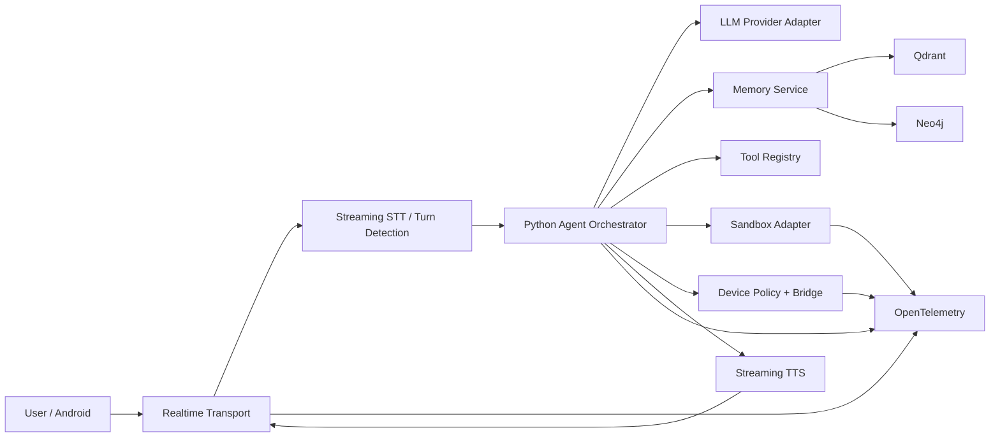

# System Architecture

## 1. Logical architecture



## 2. Service ownership

### Realtime transport
Owns:
- WebRTC/session lifecycle
- audio tracks
- data channels
- connection authentication
- media backpressure

Does not own:
- business reasoning
- persistent memory
- arbitrary tool logic

### Orchestrator
Owns:
- state machine
- planning
- routing
- tool policy
- response generation
- action approval

### Memory service
Owns:
- embeddings
- graph writes
- retrieval
- provenance
- memory lifecycle

### Sandbox service
Owns:
- isolated execution
- timeout/resource policy
- execution result

### Device bridge
Owns:
- Android authentication
- allowlisted intents
- local OS permission handling

### Dashboard
Owns:
- visibility
- debugging
- memory inspection
- configuration

## 3. Realtime path

```text
audio input
→ transport
→ turn detection
→ partial STT
→ orchestrator
→ memory retrieval in parallel
→ LLM/tool decision
→ streamed text
→ TTS
→ audio output
```

Do not wait for all memory sources serially. Vector and graph retrieval should execute concurrently and have hard deadlines.

## 4. Memory path

```text
conversation
→ candidate fact extraction
→ provenance validation
→ deduplication
→ confidence scoring
→ vector record
→ graph record
→ audit event
```

## 5. Agent topology

```text
Supervisor
├── Conversation
├── Memory
├── Tool
├── Coder
├── Device
└── Critic
```

The Supervisor is a router, not a general-purpose second LLM that rewrites everything.

## 6. Failure domains

Every external dependency must be isolated:

- LLM unavailable → fallback model / text fallback
- STT unavailable → retry or text input
- TTS unavailable → text response
- Qdrant unavailable → short-term session memory only
- Neo4j unavailable → vector-only memory
- sandbox unavailable → refuse execution, never execute locally
- device unavailable → explain and stop

## 7. Recommended transport decision

The previous document specified custom Rust WebRTC implementation as mandatory. That is not the right first implementation for a solo/portfolio build.

Use LiveKit or another mature WebRTC layer for v1. It provides WebRTC transport, media/data handling and agent abstractions. citeturn0search5turn0search13

Introduce a custom Rust gateway only after profiling proves transport overhead is material.

## 8. Data consistency

Qdrant and Neo4j are not treated as one transaction.

Use:
- immutable memory event;
- idempotent memory ID;
- retry queue;
- reconciliation worker.

This prevents split-brain memory writes.
