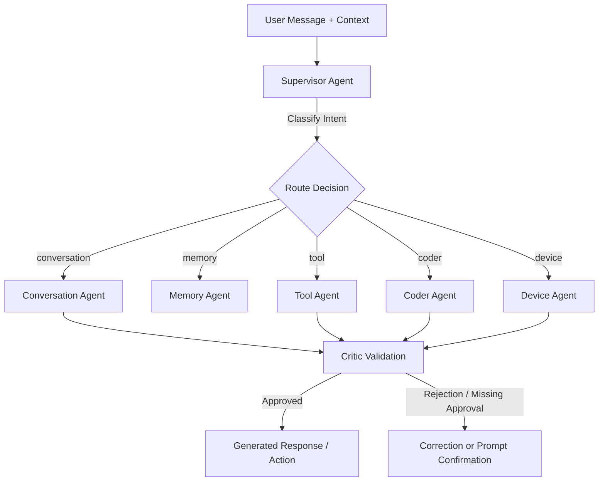

# Staged Architecture & Implementation Plan: Building HINA v1

This document outlines the phased engineering blueprint and design specifications to take **HINA** from its current Phase 0 baseline (`/v1/health` endpoint) to a complete, production-grade autonomous voice agent companion.

---

## Strategic Engineering Principle

Per [README.md](file:///d:/Projects/HINA/README.md) and [DECISIONS.md](file:///d:/Projects/HINA/DECISIONS.md), HINA is constructed **deterministically first**:

```
[Phase 1] Deterministic Agent Core (LangGraph + Supervisor + Mock/Gemini)
    │
[Phase 2] Tool Registry & Policy Gatekeeper (Typed Tools + Risk Classification)
    │
[Phase 3] Secure Code Sandbox (E2B MicroVM + Zero Host Execution + Repair Loop)
    │
[Phase 4] Hybrid Persistent Memory (Qdrant Vector + Neo4j Graph + Redis Cache)
    │
[Phase 5] Realtime Voice & Media Gateway (LiveKit WebRTC + Deepgram Flux STT/TTS)
    │
[Phase 6] Android Device Bridge (Typed Mobile Intents + Human Confirmation Gate)
    │
[Phase 7] Observability & Developer Dashboard (Next.js Dashboard + OTel Traces)
    │
[Phase 8] Production Hardening & Golden Benchmarks
```

Building in this order prevents debugging ambiguity—every layer is verifiable offline before external network and real-time voice dependencies are introduced.

---

## User Review Required

> [!IMPORTANT]
> **API Keys vs Local Offline Mocks**:
> During the initial stages (Phases 1–3), we can design all providers behind clean abstract interfaces (`LLMProvider`, `SandboxProvider`, `MemoryStore`) with local mock implementations and offline golden datasets. This allows complete end-to-end deterministic test coverage without requiring paid API tokens (Gemini, Deepgram, E2B) immediately.

> [!WARNING]
> **Host Execution Ban**:
> Per [AGENTS.md](file:///d:/Projects/HINA/AGENTS.md) and [SECURITY.md](file:///d:/Projects/HINA/SECURITY.md), code generated by the Coder Agent will strictly never execute on the host machine. While developing the sandbox adapter, we will use an isolated mock / local container boundary before hooking up remote E2B microVMs.

---

## Proposed Implementation Stages

### Stage 1: Foundation, Typed Config & Domain Models (Immediate Next Step)
Establish the configuration system, domain models, and shared exception contracts.

#### [NEW] [config.py](file:///d:/Projects/HINA/orchestrator/core/config.py)
- Pydantic `BaseSettings` reading from `.env` (environment, ports, log level, provider keys, timeouts).
- Fail-fast validation on startup.

#### [NEW] [models.py](file:///d:/Projects/HINA/orchestrator/core/models.py)
- Canonical data models matching [DATA_SPEC.md](file:///d:/Projects/HINA/DATA_SPEC.md):
  - `UserTurn`, `SessionContext`, `AgentState`, `TraceContext`.
  - `MemoryItem`, `GraphRelation`, `MobileIntent`, `ExecutionResult`.

#### [NEW] [errors.py](file:///d:/Projects/HINA/orchestrator/core/errors.py)
- Structured domain error taxonomy matching [API_SPEC.md](file:///d:/Projects/HINA/API_SPEC.md) error codes (`AUTH_REQUIRED`, `INVALID_SCHEMA`, `POLICY_DENIED`, `SANDBOX_TIMEOUT`, etc.).

---

### Stage 2: Deterministic Agent Core & Routing (Phase 1)
Build the central orchestrator state machine using LangGraph and the Supervisor routing topology defined in [AGENTS.md](file:///d:/Projects/HINA/AGENTS.md).



#### [NEW] [base.py](file:///d:/Projects/HINA/orchestrator/providers/base.py)
- `LLMProvider` abstract protocol: `generate(messages, tools, schema) -> LLMResponse`, `stream(...)`.

#### [NEW] [gemini.py](file:///d:/Projects/HINA/orchestrator/providers/gemini.py)
- Concrete provider implementing Gemini 3.8 Flash using `google-genai` SDK.

#### [NEW] [mock_llm.py](file:///d:/Projects/HINA/orchestrator/providers/mock_llm.py)
- Deterministic mock provider for golden dataset unit testing without external network dependencies.

#### [NEW] [supervisor.py](file:///d:/Projects/HINA/orchestrator/agents/supervisor.py)
- Router agent classifying intent into `conversation`, `memory`, `tool`, `coder`, or `device`.
- Confidence scoring and loop threshold caps (maximum iterations).

#### [NEW] [critic.py](file:///d:/Projects/HINA/orchestrator/agents/critic.py)
- Verifies answer groundedness, safety policy compliance, and detects missing human confirmation.

#### [NEW] [graph.py](file:///d:/Projects/HINA/orchestrator/core/graph.py)
- LangGraph state machine linking Supervisor, Specialists, and Critic.

---

### Stage 3: Tool Registry & Policy Gatekeeper
Build a safe, schema-validated tool ecosystem with risk classification.

#### [NEW] [registry.py](file:///d:/Projects/HINA/orchestrator/tools/registry.py)
- Base `Tool` protocol per [AGENTS.md](file:///d:/Projects/HINA/AGENTS.md):
  - `name`, `description`, `input_schema`, `risk_level` (`LOW` | `MEDIUM` | `HIGH`), `requires_confirmation`.
  - Asynchronous `execute(payload) -> dict`.

#### [NEW] [base_tools.py](file:///d:/Projects/HINA/orchestrator/tools/base_tools.py)
- Initial deterministic tools:
  - `calculator`: math expressions without `eval()`.
  - `time_service`: current UTC timestamp / timezone conversions.
  - `web_search_mock`: mockable search provider interface.

#### [NEW] [policy.py](file:///d:/Projects/HINA/orchestrator/policies/engine.py)
- Policy enforcement engine: inspects tool/action payloads against allowlists, rate limits, and risk thresholds.

---

### Stage 4: Secure Sandbox Subsystem (Phase 2)
Isolate code execution from the host operating system.

#### [NEW] [sandbox.py](file:///d:/Projects/HINA/orchestrator/core/sandbox.py)
- `SandboxAdapter` protocol: `execute(code: str, timeout_ms: int, network: str) -> ExecutionResult`.
- Static pre-execution checks (AST inspection to detect prohibited imports or dangerous patterns).
- Multi-step repair loop: Coder agent inspects `stderr`/exit codes and attempts at most 2 autonomous repairs.
- Integration adapter for **E2B** isolated microVMs.

---

### Stage 5: Hybrid Persistent Memory (Phase 3)
Implement the dual-engine memory architecture combining vector retrieval and knowledge graph traversal.

```
       User Statement / Interaction
                    │
                    ▼
          Memory Candidate Extractor
     (Person, Preference, Project, Event)
                    │
         ┌──────────┴──────────┐
         ▼                     ▼
┌──────────────────┐  ┌──────────────────┐
│  Qdrant Adapter  │  │  Neo4j Adapter   │
│ - Dense + Sparse │  │ - Cypher Builder │
│ - Hybrid RRF     │  │ - Graph Traversal│
│ - Provenance ID  │  │ - Relationships  │
└────────┬─────────┘  └────────┬─────────┘
         └──────────┬──────────┘
                    ▼
        Reconciliation & Event Bus
          (Audit Trail in Redis)
```

#### [NEW] [qdrant_store.py](file:///d:/Projects/HINA/orchestrator/memory/qdrant_store.py)
- Qdrant client connection, collection setup, dense & sparse vector upsert, and RRF retrieval.

#### [NEW] [neo4j_store.py](file:///d:/Projects/HINA/orchestrator/memory/neo4j_store.py)
- Parameterized Cypher query builders for entity nodes (`User`, `Person`, `Project`, `Concept`) and relations (`WORKS_ON`, `LIKES`, `USES`).

#### [NEW] [hybrid_retriever.py](file:///d:/Projects/HINA/orchestrator/memory/hybrid_retriever.py)
- Parallel execution of vector and graph queries with strict timeouts (<100 ms budget).
- Provenance validation and unified ranking.

#### [NEW] [lifecycle.py](file:///d:/Projects/HINA/orchestrator/memory/lifecycle.py)
- Cascading deletion and correction propagation across Qdrant, Neo4j, and Redis.

---

### Stage 6: Realtime Voice & Media Gateway (Phase 4)
Bidirectional audio streaming, turn detection, and interruption.

#### [NEW] [livekit_agent.py](file:///d:/Projects/HINA/orchestrator/gateway/livekit_agent.py)
- LiveKit WebRTC session management, audio track subscription, and data channel publishing.

#### [NEW] [deepgram_stt.py](file:///d:/Projects/HINA/orchestrator/providers/deepgram_stt.py)
- Deepgram Flux streaming audio client (`/v2/listen`) with 80 ms audio chunk streaming and turn detection.

#### [NEW] [streaming_tts.py](file:///d:/Projects/HINA/orchestrator/providers/streaming_tts.py)
- Streaming TTS delivery with immediate interrupt/barge-in cutoff when user speaks.

---

### Stage 7: Android Device Bridge (Phase 5)
Controlled, authenticated mobile intent execution.

#### [NEW] [intent_validator.py](file:///d:/Projects/HINA/orchestrator/devices/intent_validator.py)
- Validates requests against [mobile_intent.schema.json](file:///d:/Projects/HINA/config/schemas/mobile_intent.schema.json).
- Nonce and timestamp verification to prevent replay attacks.

#### [NEW] [device_manager.py](file:///d:/Projects/HINA/orchestrator/devices/device_manager.py)
- Device registration, short-lived JWT tokens, action confirmation tokens, and revocation state.

---

### Stage 8: Observability, Developer Dashboard & Hardening (Phases 6–8)
- OpenTelemetry spans for turn detection, LLM generation, retrieval, and tool execution.
- Next.js Web Dashboard for live session inspection, memory graph visualization, and action approvals.
- Full security penetration and golden regression suites.

---

## Verification Plan

### Automated Tests
- **Pydantic Model & Schema Validation**:
  ```bash
  pytest tests/test_schemas.py
  ```
- **Supervisor Routing Golden Tests** (50+ scenarios):
  ```bash
  pytest tests/golden/test_router_golden.py
  ```
- **Tool Policy & Sandbox Isolation Tests**:
  ```bash
  pytest tests/security/test_sandbox_policy.py
  ```
- **Memory Retrieval & Provenance Tests**:
  ```bash
  pytest tests/integration/test_memory_hybrid.py
  ```
- **Static Analysis & Type Checking**:
  ```bash
  ruff check .
  mypy --strict .
  ```

---

## Open Questions

1. **Initial Development Provider**: Would you prefer we start Phase 1 using **Google Gemini 3.8 Flash** directly with your API key, or first build with the **Mock Provider + Golden Test Suite** so everything can run completely offline?
2. **Local Services**: Should we verify and spin up your local Docker containers for Qdrant, Neo4j, and Redis now, or focus first on the pure in-memory Python orchestrator abstractions?
